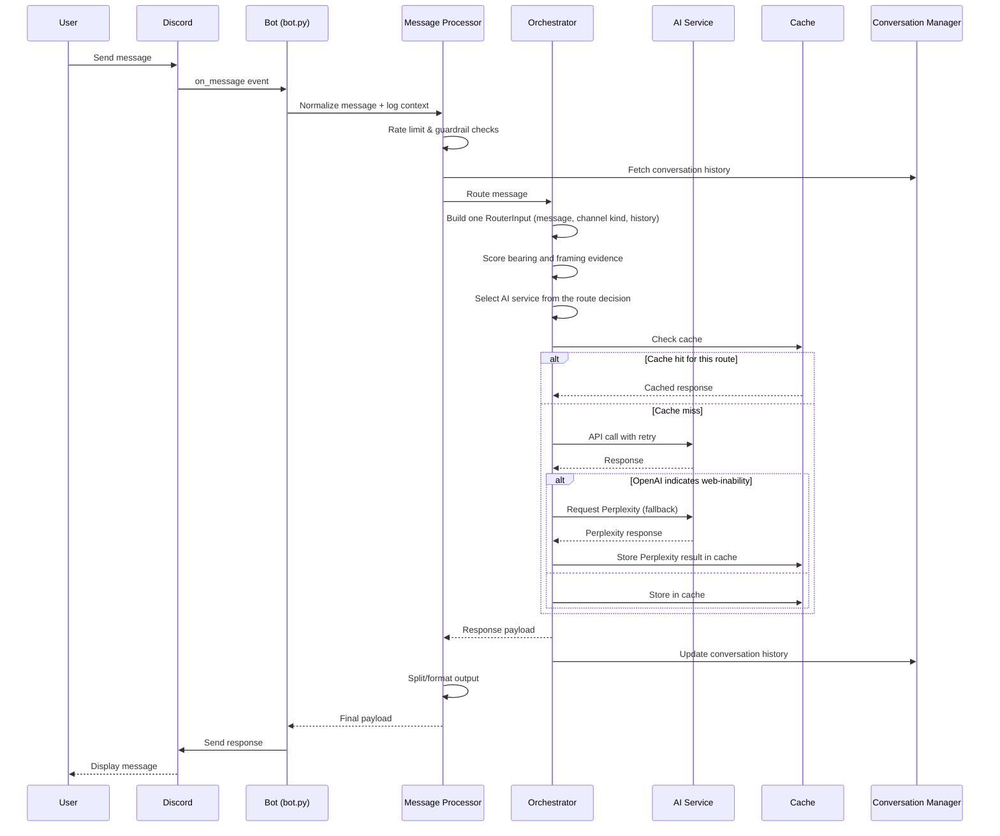

# DiscordianAI Architecture

This document provides a comprehensive overview of the DiscordianAI system architecture, design patterns, and component interactions.

## 📐 High-Level Architecture

```
┌────────────────────────────────────────────────────────────────────────────────────────┐
│ Discord Gateway                                                                         │
└────────────────────────────────────────────────┬───────────────────────────────────────┘
                                                 │
                                                 ▼
┌────────────────────────────────────────────────────────────────────────────────────────┐
│ Entry & Routing                                                                         │
│   entry point · event handlers · message router · dependency container · shared models  │
└────────────────────────────────────────────────┬───────────────────────────────────────┘
                                                 │
                                                 ▼
┌────────────────────────────────────────────────────────────────────────────────────────┐
│ Discord Presentation                                                                    │
│   embeds and citations · message splitting and sanitization · URL validation and scraping│
└────────────────────────────────────────────────┬───────────────────────────────────────┘
                                                 │
                                                 ▼
┌────────────────────────────────────────────────────────────────────────────────────────┐
│ Orchestration & AI Selection                                                            │
│   evidence-based routing · OpenAI processing · Perplexity processing                      │
└────────────────────────────────────────────────┬───────────────────────────────────────┘
                                                 │
                                                 ▼
┌────────────────────────────────────────────────────────────────────────────────────────┐
│ Infrastructure & Resilience                                                             │
│   connection pooling · caching · error handling and circuit breakers · conversations     │
│   rate limits · health probes · API context · structured logging · dependency checks     │
└────────────────────────────────────────────────┬───────────────────────────────────────┘
                                                 │
                                                 ▼
┌────────────────────────────────────────────────────────────────────────────────────────┐
│ Shared Support & Packaging                                                              │
│   configuration · type hints                                                            │
└────────────────────────────────────────────────────────────────────────────────────────┘
```

## 🧩 Component Overview

### Entry Points

| Component | File | Purpose |
|-----------|------|---------|
| **Main** | `main.py` | Application entry point, startup sequence, logging setup |
| **Bot** | `bot.py` | Discord client initialization, event handlers, graceful shutdown |

### Core Processing

| Component | File | Purpose |
|-----------|------|---------|
| **Smart Orchestrator** | `smart_orchestrator.py` | AI service selection logic based on message analysis |
| **OpenAI Processing** | `openai_processing.py` | GPT API interactions, response formatting |
| **Perplexity Processing** | `perplexity_processing.py` | Web search, citation extraction |
| **Web Scraper** | `web_scraper.py` | URL content extraction for context enrichment |

### Infrastructure

| Component | File | Purpose |
|-----------|------|---------|
| **Config** | `config.py` | Configuration loading and constants |
| **Connection Pool** | `connection_pool.py` | HTTP/2 connection pooling for API clients |
| **Caching** | `caching.py` | Response caching, request deduplication |
| **Error Handling** | `error_handling.py` | Circuit breaker, retry logic, error classification |
| **Conversation Manager** | `conversation_manager.py` | Thread-safe conversation history |
| **Rate Limiter** | `rate_limits.py` | Per-user rate limiting |
| **Health Checks** | `health_checks.py` | API health monitoring, metrics |
| **Health Server** | `health_server.py` | HTTP liveness/readiness probes (Kubernetes-compatible) |
| **API Context** | `api_context.py` | Context managers for API call lifecycle, timing, and error tracking |
| **Structured Logging** | `structured_logging.py` | structlog configuration and structured logger factory |
| **Dependencies** | `dependencies.py` | `BotDependencies` dataclass for formal dependency injection |

### Discord Integration

| Component | File | Purpose |
|-----------|------|---------|
| **Discord Bot** | `discord_bot.py` | Activity status, presence management |
| **Discord Embeds** | `discord_embeds.py` | Citation formatting, embed creation |
| **Message Processor** | `message_processor.py` | Normalizes Discord events, delegates to orchestrator, records metadata |
| **Message Splitter** | `message_splitter.py` | Message splitting, formatting, sanitization |
| **API Validation** | `api_validation.py` | Configuration validation, API key format checks |

## ⚙️ Operational Features

- **Rate Limiting** (`rate_limits.py`): Per-user buckets enforce `[Limits]` from config.ini so spam never overwhelms upstream APIs.
- **Conversation History** (`conversation_manager.py`): Thread-safe per-conversation transcripts preserve context while pruning automatically. A conversation key is `g:<guild>:c:<channel>` for a guild channel or thread, or `dm:<user>` for a direct message; a thread uses its own channel id, so it never shares history with its parent.
- **Activity & Presence** (`discord_bot.py` + config): Status text, presence state, and activity type are configurable at runtime.
- **Direct Messages** (`bot.py`): DM sessions bypass mention requirements but still honor rate limits and consistency checks.
- **Channel Targeting** (`message_router.py`): `ALLOWED_CHANNELS` gating ensures the bot only replies where it is expected.
- **Smart Message Splitting** (`message_splitter.py`): Discord-safe splitting protects code blocks, embeds, and citations from truncation.
- **Global Exception Handling** (`error_handling.py` + `bot.py`): Centralized logging and graceful fallbacks keep the process alive after faults.
- **Health Server** (`health_server.py`): Lightweight HTTP endpoint for liveness/readiness probes, compatible with Kubernetes and load balancers.

## 🔄 Request Flow



## 🎯 Design Patterns

### 1. Dependency Injection

The bot uses a typed `BotDependencies` dataclass to pass dependencies between components:

```python
from src.dependencies import BotDependencies

deps = BotDependencies(
    bot=discord_client,
    logger=logger,
    config=config,
    client=openai_client,
    perplexity_client=perplexity_client,
    rate_limiter=rate_limiter,
    conversation_manager=conversation_manager,
)
```

The dataclass supports dict-style access (`deps["logger"]`, `deps.get("key")`, `"key" in deps`) and `.to_dict()` for backward compatibility with legacy code.

**Benefits:**
- Typed dependencies with IDE autocompletion
- Testable components (easy to mock)
- Loose coupling between modules
- Configuration flexibility with backward-compatible dict access

### 2. Circuit Breaker Pattern

The breaker lives in `error_handling.py`. `get_circuit_breaker()` returns one
shared `CircuitBreaker` per provider (`openai`, `perplexity`), and the provider
processing modules wrap the whole retry sequence for one logical API call in
`breaker.call(...)`:

```python
class CircuitBreaker:
    """States: CLOSED → OPEN → HALF_OPEN → CLOSED"""

    def __init__(self, failure_threshold=5, timeout=60, ...):
        self.failure_threshold = failure_threshold
        self.timeout = timeout
        self.state = "CLOSED"
```

**State Transitions:**
- **CLOSED**: Normal operation, requests pass through.
- **OPEN**: After 5 failed logical calls, reject requests immediately. Retries
  inside one call do not add to the count: one call that exhausts its attempts
  is one failure. A stale count is reset when the next failure arrives more
  than 60 seconds after the previous one.
- **HALF_OPEN**: After the 60-second timeout, admit one probe request. Other
  calls fail fast until it finishes; success closes the breaker and resets the
  count, failure reopens it.

The health server publishes each breaker's state through
`get_circuit_breaker_states()`.

### 3. Decorator-Based Caching

```python
@cached_response(ttl=300)
@deduplicated_request()
async def _fetch_openai_response(...):
    ...
```

These decorators wrap `_fetch_openai_response()` in `src/openai_processing.py`; `_extract_message_context()` is the shared helper that supplies the cache and deduplication scope.

**Features:**
- TTL-based expiration
- Request deduplication (prevents duplicate API calls)
- Thread-safe LRU cache

### 4. Thread-Safe Conversation Management

```python
class ThreadSafeConversationManager:
    def __init__(self):
        self._conversations: dict[int, list[dict]] = {}
        self._user_locks: dict[int, threading.RLock] = {}
        self._global_lock = threading.RLock()
```

**Features:**
- Per-user locking for fine-grained concurrency
- Automatic history pruning
- Deep copy returns to prevent external modification

### 5. Retry with Exponential Backoff and Jitter

```python
DEFAULT_API_RETRY_CONFIG = RetryConfig(
    max_attempts=2,
    base_delay=1.0,
    max_delay=30.0,
    exponential_base=2.0,
    jitter=True,
    max_elapsed=90.0,
)
```

`max_attempts=2` means one initial request plus one retry. The exponential
delay is capped at 30 seconds, then full jitter picks a random value below it;
a 90-second overall deadline stops retries even when attempts remain.

## 🔐 Security Architecture

### API Key Handling
- Keys loaded from config files or environment variables
- Format validation before use (sk-*, pplx-*)
- Never logged or exposed in error messages

### Input Validation
- Message content sanitization
- URL validation patterns
- Rate limiting per user

### Pre-commit Hooks
- `detect-secrets` prevents accidental key commits

## 📊 Observability

### Logging
- Structured logging with configurable levels
- Exactly one stream handler on the root logger; the supervisor owns any file redirection
- Request/response metadata logging

### Health Checks
- API connectivity monitoring
- Model availability validation
- Connection pool health metrics

### Metrics (via `APIHealthMetrics`)
- Total/successful/failed checks
- Average response times
- Consecutive failure tracking
- Uptime percentage

## 🚀 Performance Optimizations

### Connection Pooling
```python
from src.connection_pool import ConnectionPoolManager

pool = ConnectionPoolManager()
openai_client = pool.create_openai_client(openai_api_key, openai_base_url)
perplexity_client = pool.create_perplexity_client(perplexity_api_key, perplexity_base_url)
```

### Caching Strategy
- Response cache: 5-minute TTL
- Conversation cache: 30-minute TTL
- LRU eviction with 1000 entry limit

### Async Everything
- All API calls are async
- Discord.py async event loop
- Non-blocking conversation updates

## 🧪 Testing Architecture

```
tests/
├── fixtures/              # Shared configuration fixtures
└── test_*.py              # Unit, integration, security, and documentation contract tests
```

The suite is organised by behaviour: configuration and startup, routing and
conversation scope, provider and retry policy, scraper security and budgets,
message delivery, health, and documentation truth.

**Coverage Target:** 84%+ (enforced by CI)

## 📁 Project Structure

```
DiscordianAI/
├── src/                    # Application modules
├── tests/                  # Test suite
├── docs/                   # Documentation and Sphinx API pages
├── scripts/                # Operational helper scripts
├── contrib/                # Service and logrotate assets
├── config.ini.example      # Configuration template
├── Dockerfile              # Container image
├── docker-compose.yml      # Container orchestration
├── pyproject.toml          # Build and tool configuration
└── requirements.txt        # Runtime dependencies
```

## 🔮 Future Considerations

### Potential Improvements
1. **Protocol Classes**: Define interfaces for AI clients (pre-empt multi-platform support)
2. **Metrics Export**: Prometheus/OpenTelemetry integration
3. **Message Queue**: For high-volume deployments

### Scalability Path
- Current: Single instance, in-memory state
- Future: Redis for distributed caching/rate limiting
- Future: Multiple bot instances with shared state
