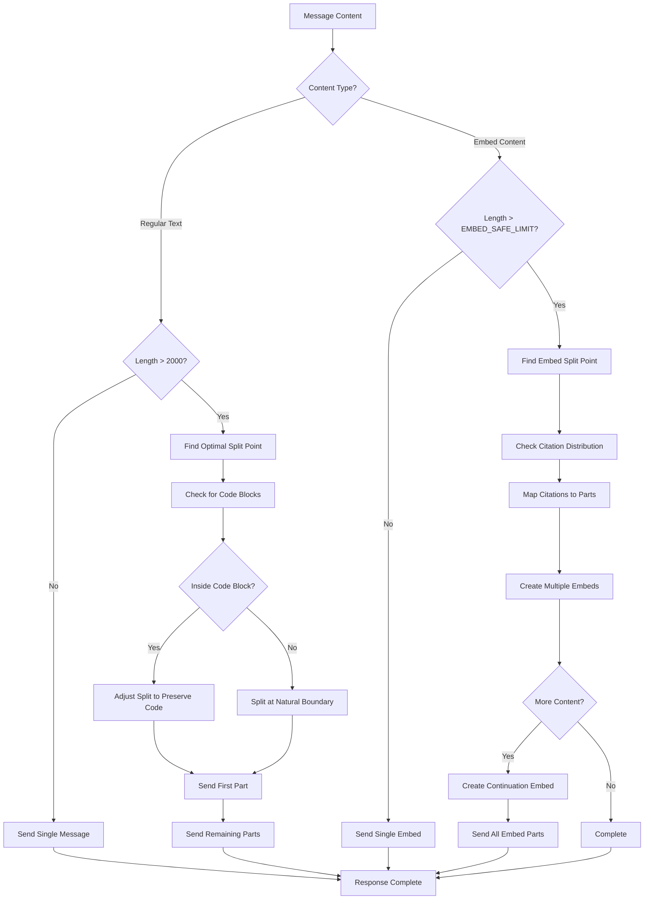
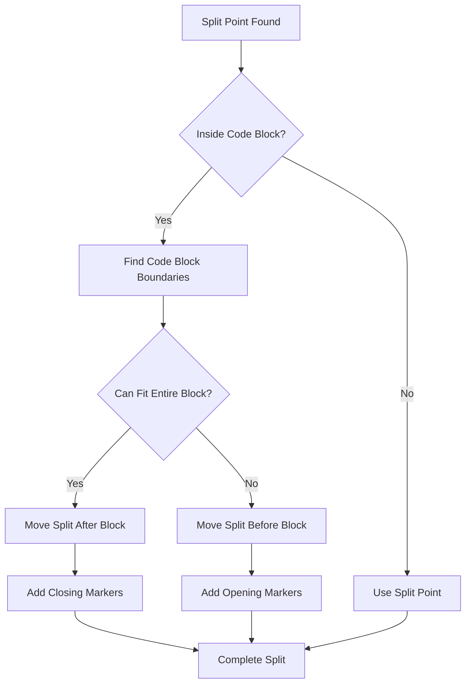
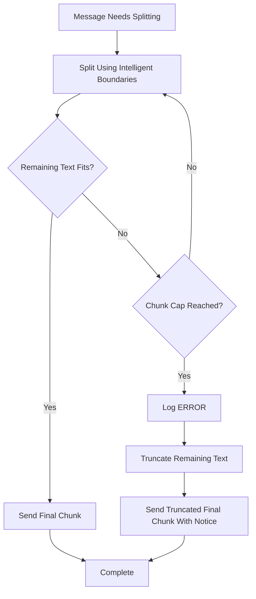

# Message Splitting & Character Limits

DiscordianAI implements intelligent message splitting to handle Discord's character limits while preserving formatting, code blocks, and citation functionality.

> **Note**: The constants `EMBED_LIMIT` and `EMBED_SAFE_LIMIT` referenced in this document are defined in `src/config.py`.

## Discord Character Limits

### Regular Messages
- **Limit**: 2000 characters
- **Usage**: OpenAI responses, plain text
- **Splitting**: Intelligent boundary detection

### Embed Descriptions  
- **Hard Limit**: 4096 characters (`EMBED_LIMIT` - Discord maximum)
- **Safe Limit**: 3840 characters (`EMBED_SAFE_LIMIT` - safe margin for citations)
- **Usage**: Perplexity responses with citations
- **Splitting**: Citation-aware splitting

#### Why Use a Safe Limit?

The 3840-character safe limit (`EMBED_SAFE_LIMIT`) provides a 256-character safety buffer (6.25%) for:

- **Citation Expansion**: `[1]` becomes `[[1]](https://very-long-url...)` (~15-20x expansion)
- **Footer Text**: "📚 5 sources" and continuation markers
- **Unicode Encoding**: Some characters require multiple bytes
- **Future-Proofing**: Room for additional formatting without breaking

## Message Splitting Algorithm

DiscordianAI uses a sophisticated message splitting algorithm that ensures content integrity while respecting Discord's character limits. The system includes a chunk-count safety cap and intelligent boundary detection.

The following diagram shows how messages are intelligently split:



## Split Point Detection

### Priority Order
1. **Newline boundaries** - Preserve paragraph structure
2. **Sentence endings** - Maintain readability (. ! ?)
3. **Word boundaries** - Avoid cutting words in half
4. **Character limit** - Fallback when no good boundaries exist

### Code Block Preservation



## Citation-Aware Splitting

For Perplexity responses with citations, the splitting algorithm ensures citations remain functional:

```mermaid
flowchart TD
    A[Long Citation Content] --> B[Split at EMBED_SAFE_LIMIT]
    B --> C[Analyze Citation References]
    
    C --> D[Part 1: Citations 1-3]
    C --> E[Part 2: Citations 4-6]
    
    D --> F[Create Embed 1]
    E --> G[Create Embed 2]
    
    F --> H[Footer: "Web search results"]
    G --> I[Footer: "Web search results (continued)"]
    
    H --> J[Send Embed 1]
    I --> K[Send Embed 2]
    
    J --> L[All Citations Clickable]
    K --> L
```

## Code Examples

### Regular Message Splitting

```python
await send_split_message(
    channel,
    message,
    deps,
    suppress_embeds=False,
    original_message=original_message,
    mention_prefix=f"{user.mention} ",
)
```

### Embed Splitting with Citations

```python
await send_split_message_with_embed(
    channel,
    message,
    deps,
    embed,
    citations,
    original_message=original_message,
    mention_prefix=f"{user.mention} ",
)
```

## Split Point Algorithm

### Finding Optimal Boundaries

```python
def find_optimal_split_point(message: str, target_index: int) -> int:
    """Find the best place to split a message near the target index."""
    
    # Search window around target (±50 characters)
    search_start = max(0, target_index - 50)
    search_end = min(len(message), target_index + 50)
    search_area = message[search_start:search_end]
    
    # Priority 1: Newline boundaries
    newlines = [i for i, char in enumerate(search_area) if char == '\n']
    if newlines:
        return search_start + max(newlines) + 1
    
    # Priority 2: Sentence endings
    sentences = []
    for i, char in enumerate(search_area):
        if char in '.!?' and i < len(search_area) - 1:
            if search_area[i + 1] == ' ':
                sentences.append(i + 1)
    if sentences:
        return search_start + max(sentences)
    
    # Priority 3: Word boundaries
    words = [i for i, char in enumerate(search_area) if char == ' ']
    if words:
        return search_start + max(words)
    
    # Fallback: Use target index
    return target_index
```

## Best Practices

### For Developers

1. **Always check content length** before sending
2. **Use appropriate limits** (2000 for messages, `EMBED_SAFE_LIMIT` for embeds)
3. **Preserve formatting** when splitting
4. **Test with long content** to verify splitting works
5. **Handle edge cases** like very long words or URLs

### For Bot Configuration

1. **Set reasonable response limits** in AI API calls
2. **Monitor splitting frequency** in logs
3. **Test citation distribution** with long Perplexity responses
4. **Verify code block preservation** works correctly

## Troubleshooting

### Common Issues

**Messages cut off mid-word**:
- Check `find_optimal_split_point()` implementation
- Verify word boundary detection is working

**Code blocks broken across messages**:
- Ensure `adjust_split_for_code_blocks()` is called
- Check code block detection patterns

**Citations not working in split embeds**:
- Verify citation mapping is preserved
- Check that continuation embeds include relevant citations

**Splitting stops at the chunk cap**:
- Check the maximum chunk count (50)
- Ensure the upstream provider is not returning far more text than its output budget allows
- A single indivisible unit that cannot fit is truncated with a visible notice; this is expected

### Performance Considerations

- **Split point calculation**: O(n) where n is search window size
- **Code block detection**: O(n) where n is message length  
- **Citation mapping**: O(c) where c is number of citations
- **Memory usage**: Minimal additional overhead

## Chunk Cap Protection

### How It Works

Splitting is iterative: the chunk list is computed up front and then sent in a loop. The chunk count is capped to stop a runaway response from producing hundreds of messages:

1. **Normal Splitting**: Messages are split using intelligent boundary detection until the remaining text fits.
2. **Chunk Cap Hit**: At 50 chunks the splitter logs an ERROR and stops, because no legitimate provider response needs that many messages.
3. **Indivisible Unit**: If one code fence or word cannot be split within the limit, the remaining text is truncated with a visible notice.

### Chunk Cap Flow



### Benefits

- **Content Preservation**: Full-length provider answers are delivered in full, with no recursion-depth cutoff.
- **Runaway Guard**: A pathological response stops at a bounded number of messages.
- **User Awareness**: A visible truncation notice is reserved for text that genuinely cannot be split.

## Advanced Configuration

### Customizing Split Behavior

```python
# Discord limits used by the splitter
MESSAGE_LIMIT = 2000
EMBED_SAFE_LIMIT = 3840

# Maximum number of chunks sent for one message
MAX_SPLIT_CHUNKS = 50

# Prefer the helpers from ``src.message_splitter`` instead of duplicating the logic.
```

### Monitoring Split Operations

```python
# Log split operations for debugging
logger.debug(f"Splitting message: {len(message)} chars")
logger.debug(f"Split point found at index {split_point}")
logger.debug(f"Parts: {len(chunk)} chars, {len(chunks)} chunk(s) planned")
```
