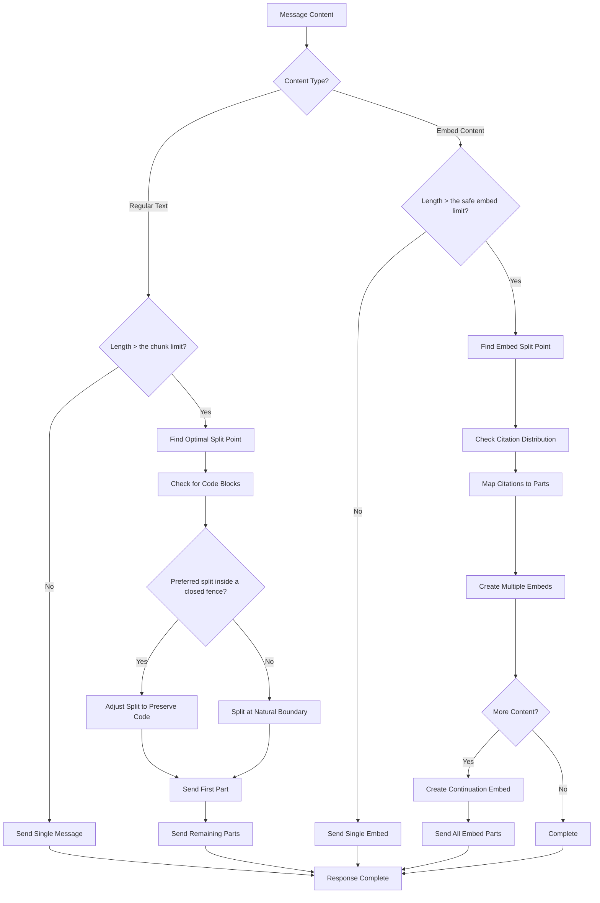
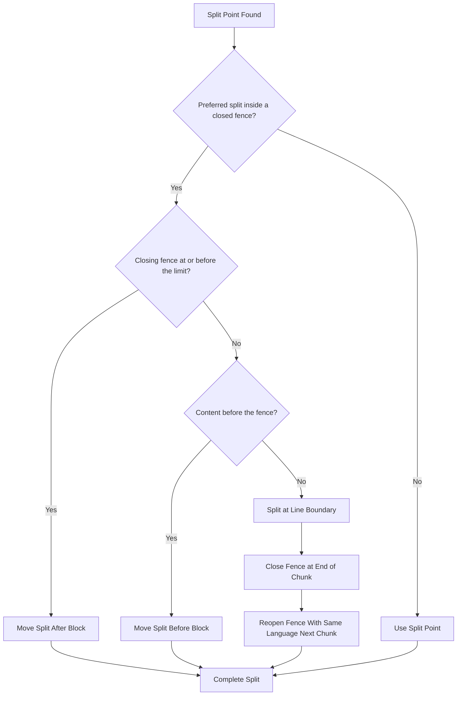
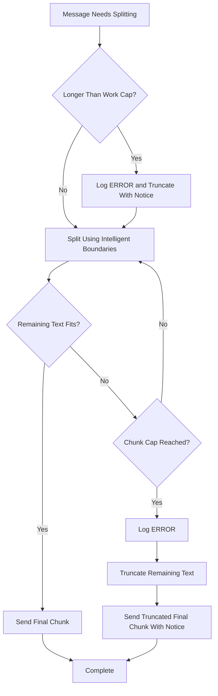

# Message Splitting & Character Limits

DiscordianAI implements intelligent message splitting to handle Discord's character limits while preserving formatting, code blocks, and citation functionality.

> **Note**: The constants `EMBED_LIMIT` and `EMBED_SAFE_LIMIT` referenced in this document are defined in `src/config.py`.

## Delivery Policy

Every model-derived answer is sent with `channel.send` by the private `_deliver()` helper in
`src/message_splitter.py`. When there is an original message, the helper builds the reply
reference with `to_reference(fail_if_not_exists=False)`, so the answer still arrives if the
question was deleted, disables the implicit author mention with `mention_author=False`, and
allows mentions only for the human author. No module calls `Message.reply`; fixed operational
notices use `error_handling.safe_discord_send()` instead of this path.

## Discord Character Limits

### Regular Messages
- **Limit**: 2000 characters
- **Usage**: OpenAI responses, plain text
- **Splitting**: Intelligent boundary detection

### Embed Descriptions  
- **Hard Limit**: 4096 characters (`EMBED_LIMIT` - Discord maximum)
- **Safe Limit**: 3840 characters (`EMBED_SAFE_LIMIT` - safe margin for citations)
- **Usage**: Perplexity responses with citations
- **Splitting**: Citation-aware splitting

#### Why Use a Safe Limit?

The 3840-character safe limit (`EMBED_SAFE_LIMIT`) provides a 256-character safety buffer (6.25%) for:

- **Citation Expansion**: `[1]` becomes `[[1]](https://very-long-url...)` (~15-20x expansion)
- **Footer Text**: "📚 5 sources" and continuation markers
- **Unicode Encoding**: Some characters require multiple bytes
- **Future-Proofing**: Room for additional formatting without breaking

## Message Splitting Algorithm

DiscordianAI uses a sophisticated message splitting algorithm that ensures content integrity while respecting Discord's character limits. The system includes a chunk-count safety cap and intelligent boundary detection.

The following diagram shows how messages are intelligently split:



## Split Point Detection

### Priority Order
1. **Newline boundaries** - Preserve paragraph structure
2. **Sentence endings** - Maintain readability (. ! ?)
3. **Word boundaries** - Avoid cutting words in half
4. **Character limit** - Fallback when no good boundaries exist

### Code Block Preservation

A split never leaves a closed code fence unbalanced. If the preferred split point falls
inside a fenced block:

1. When the block ends within the chunk limit, the split moves after the block.
2. Otherwise, when there is content before the block, the split moves before it.
3. Otherwise the split moves to a line boundary inside the block, closes the fence at the
   end of the chunk, and reopens it with the same language tag at the start of the next
   chunk. A single line longer than the available space is hard-wrapped; it is not dropped.



## Link and Code Protection

Sanitisation and splitting both call the conservative `_filtered_code_regions()` filter in
`src/message_splitter.py`, built on `tree-sitter-markdown`; the public
`protected_code_regions()` wraps it. Protection is deliberately smaller than the parser's
view:

- A fenced block is protected only when its opener and closer are exactly three backticks,
  Discord's sequential pairing of triple-backtick runs pairs those two markers, and the
  text contains no other unmatched triple-backtick run. A stray triple-backtick run between
  the opener and closer, including a run inside the content, makes the whole text ordinary.
  Tilde fences, four-or-more-backtick fences, indented code blocks, unclosed fences, and a
  text with any stray triple run protect nothing.
- An inline code span is protected only when it is closed, its opener and closer are the next
  sequential backtick pair Discord would use, neither its opener nor its closer is
  backslash-escaped, the text uses a single backtick run length, and its content carries no
  emphasis, strikethrough, or spoiler marker and no scheme-qualified link syntax. Mixing run
  lengths or an ambiguous marker means Discord may pair the backticks elsewhere, so that
  span is dropped and its contents are sanitised as ordinary text.
- Anything uncertain is ordinary text.
- A message with more than 2,048 emphasis, strikethrough, or spoiler marker characters
  skips the inline grammar entirely. The catch-all passes still neutralise every link, the
  mention protection still runs, and the block grammar still protects a closed fence; the
  cap only stops delimiter-dense text from spending seconds in the inline parser.
- Nested link labels are rendered only 100 levels deep. Beyond that the remaining label is
  ordinary text, so adversarial nesting cannot exhaust the Python stack.

Outside protected regions the sanitiser has two layers. The parser-driven layer rewrites
links, images, and autolinks to their label text with the URL neutralised, except for a
trusted citation URL from the allowlist. The catch-all layer does not depend on a parse:
it breaks every `](`, inserts a zero-width space after every `://`, and separates `<` from
a following URL scheme. Definition-shaped lines such as `[label]: destination` stay in the
text; an invisible separator stops a CommonMark renderer from resolving them, and no line
is ever deleted. Mentions are neutralised everywhere, including inside code. A lone UTF-16
surrogate is replaced with `?` before parsing, because it cannot be UTF-8 encoded and would
otherwise abort delivery of the whole answer.

After splitting, every final chunk is sanitised again on its own. A URL that was inside an
inline code span at the whole-message level is therefore neutralised when a split cuts the
span before its closer. Fences are closed at the end of a chunk and reopened with the same
language tag in the next. A split-only Discord pairing places boundaries for backtick runs
that CommonMark does not treat as a fence; those extra spans never suppress sanitisation.
The pairing is computed once per delivery, in one forward pass, and every later split walks
an offset into that plan instead of reparsing the remaining text.

## Citation-Aware Splitting

For Perplexity responses with citations, the splitting algorithm ensures citations remain functional. An embed head is also snapped so a split never falls inside a `[n]` citation marker or inside a code fence: a marker that would be cut moves whole into the next embed, and a long fence is closed and reopened with the same language tag. Every embed description is clamped to Discord's 4096-character hard limit after sanitisation, with the existing `...` marker when text is cut.

```mermaid
flowchart TD
    A[Long Citation Content] --> B[Split at EMBED_SAFE_LIMIT]
    B --> C[Analyze Citation References]
    
    C --> D[Part 1: Citations 1-3]
    C --> E[Part 2: Citations 4-6]
    
    D --> F[Create Embed 1]
    E --> G[Create Embed 2]
    
    F --> H[Footer: "Web search results"]
    G --> I[Footer: "Web search results (continued)"]
    
    H --> J[Send Embed 1]
    I --> K[Send Embed 2]
    
    J --> L[All Citations Clickable]
    K --> L
```

## Code Examples

### Regular Message Splitting

```python
await send_split_message(
    channel,
    message,
    deps,
    suppress_embeds=False,
    original_message=original_message,
    mention_prefix=f"{user.mention} ",
)
```

### Embed Splitting with Citations

```python
await send_split_message_with_embed(
    channel,
    message,
    deps,
    embed,
    citations,
    original_message=original_message,
    mention_prefix=f"{user.mention} ",
)
```

## Split Point Algorithm

### Finding Optimal Boundaries

`find_optimal_split_point(message, target_index)` searches from 100 characters before the
target to 100 characters after it. It prefers the last newline in that window and returns
the position just after it. Without a newline it picks the sentence ending (`.`, `!`, or `?`
followed by whitespace) nearest the target, which may lie on either side. If neither exists
it backs up to the last space before the target and returns the position just after it;
failing that, it returns the target itself. The function only chooses the boundary;
`split_fence_aware` then applies the code-fence rules and every final chunk is sanitised
again before delivery. See `find_optimal_split_point` in `src/message_splitter.py`.

## Best Practices

### For Developers

1. **Always check content length** before sending
2. **Use appropriate limits** (2000 for messages, `EMBED_SAFE_LIMIT` for embeds)
3. **Preserve formatting** when splitting
4. **Test with long content** to verify splitting works
5. **Handle edge cases** like very long words or URLs

### For Bot Configuration

1. **Set reasonable response limits** in AI API calls
2. **Monitor splitting frequency** in logs
3. **Test citation distribution** with long Perplexity responses
4. **Verify code block preservation** works correctly

## Troubleshooting

### Common Issues

**Messages cut off mid-word**:
- Check `find_optimal_split_point()` implementation
- Verify word boundary detection is working

**Code blocks broken across messages**:
- Long fences are split at a line boundary, closed at the end of each chunk, and reopened with the same language tag
- A closed fence split with an odd number of marker lines is a bug; check `split_fence_aware()`

**Citations not working in split embeds**:
- Verify citation mapping is preserved
- Check that continuation embeds include relevant citations

**Splitting stops at the chunk cap**:
- Check the maximum chunk count (50)
- Ensure the upstream provider is not returning far more text than its output budget allows
- Only the work cap (100,000 characters) and the chunk cap truncate content; a single line wider than the limit is hard-wrapped, not dropped
- The notice reports the original answer length and says the bot's delivery limit was reached

### Performance Considerations

- **Split point calculation**: O(1) around the boundary; only the 200-character search window is examined
- **Code block detection**: O(n) once per delivery, where n is message length; the fence spans are reused for every chunk
- **Chunk splitting**: O(n) overall; each split walks an offset into the original text instead of rescanning or reparsing the remainder
- **Citation mapping**: O(c) where c is number of citations
- **Memory usage**: Minimal additional overhead

## Chunk Cap Protection

### How It Works

Splitting is iterative: the chunk list is computed up front and then sent in a loop. The chunk count is capped to stop a runaway response from producing hundreds of messages:

1. **Work Cap**: Before sanitisation or parsing, an answer longer than `MAX_SPLIT_CHUNKS` times `MESSAGE_LIMIT` (50 × 2000 = 100,000 characters with the defaults) is truncated with the same notice and ERROR log line the chunk cap already used. No scan sees more than the maximum deliverable size.
2. **Normal Splitting**: Messages are split using intelligent boundary detection until the remaining text fits.
3. **Chunk Cap Hit**: At 50 chunks the splitter logs an ERROR and stops, because no legitimate provider response needs that many messages.
4. **Indivisible Unit**: A code fence is split at a line boundary with balanced fences, and a single line wider than the limit is hard-wrapped. Only the work cap and the chunk cap truncate content.
5. **Cap Notice**: The final chunk carries a visible notice with the original answer length and the bot's delivery limit.

### Chunk Cap Flow



### Benefits

- **Content Preservation**: Full-length provider answers are delivered in full, with no recursion-depth cutoff; long code fences keep every line and each chunk has balanced fences.
- **Runaway Guard**: A pathological response stops at a bounded number of messages.
- **Bounded Work**: An oversized or crafted answer is capped before parsing, so delivery stays linear in the input size instead of stalling the Discord event loop.
- **User Awareness**: The truncation notice is reserved for the work cap and the chunk cap, and reports the original answer length and the bot's delivery limit.

## Provider Length-Limit Notice

A provider answer can stop before it is finished when it reaches the configured output-token
cap. DiscordianAI treats that as a partial answer, not a complete one:

- The chat-completions adapter reports its `finish_reason: length`.
- The Perplexity Agent adapter normalises `status: incomplete` with
  an `incomplete_details` object whose reason is `max_output_tokens` to the same `length` signal.
- The orchestrator passes the partial text to delivery unchanged; the fixed notice is appended
  only when the answer is sent.
- The notice is one constant line, `TRUNCATION_NOTICE`, appended by
  `append_truncation_notice()`. It is never part of the model output or the conversation
  history, so follow-up turns do not replay it.
- An embed answer carries the notice in its description; a plain answer carries it inside the
  final text chunk.

## Advanced Configuration

### Customizing Split Behavior

```python
# Discord limits used by the splitter
MESSAGE_LIMIT = 2000
EMBED_SAFE_LIMIT = 3840

# Maximum number of chunks sent for one message
MAX_SPLIT_CHUNKS = 50

# Prefer the helpers from ``src.message_splitter`` instead of duplicating the logic.
```

### Monitoring Split Operations

```python
# Log split operations for debugging
logger.debug(f"Splitting message: {len(message)} chars")
logger.debug(f"Split point found at index {split_point}")
logger.debug(f"Parts: {len(chunk)} chars, {len(chunks)} chunk(s) planned")
```
