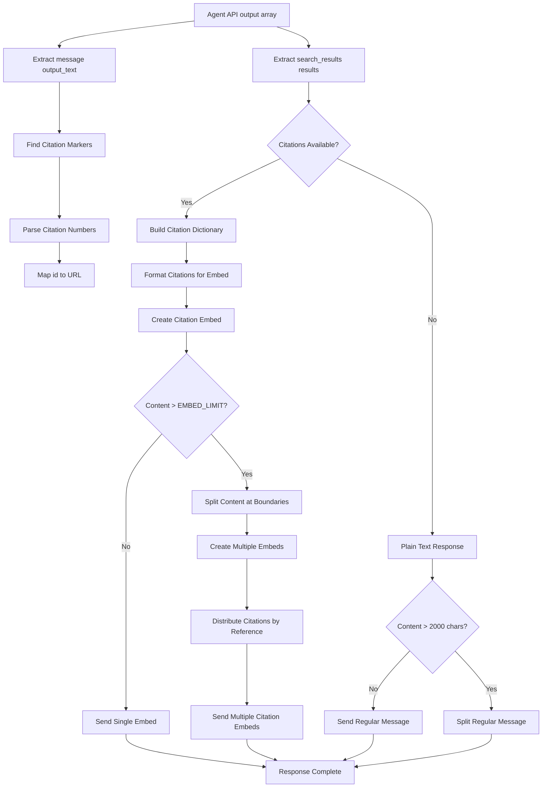

# Perplexity Integration Guide

DiscordianAI provides comprehensive Perplexity integration for real-time web search capabilities with intelligent URL content extraction, citation formatting, and embed suppression for optimal Discord experience.

## Supported Models

### Perplexity Sonar (Current)
The Agent API catalogue lists one Sonar model, `perplexity/sonar`, and it is the
bot's default:

- **Real-time information access** from current web sources
- **Automatic citation extraction** with numbered `[n]` source links
- **Web search on every call** through the `web_search` tool

The legacy Sonar names (`sonar`, `sonar-pro`, `sonar-deep-research`,
`sonar-reasoning-pro`) still answer on Chat Completions, but that interface is
not what this bot uses.

## Agent API Request and Response

The bot calls the Agent API through the OpenAI SDK's `responses.create()`:

- **Endpoint**: `POST https://api.perplexity.ai/v1/agent`, with
  `POST /v1/responses` as the OpenAI-compatible alias used by the SDK.
- **Request fields**: `model`, `instructions` (the system prompt), `input` (the
  prior turns and current user message), `max_output_tokens`, and
  `tools: [{"type": "web_search"}]`. No `temperature` is sent.
- **Response**: an `output` array. A `search_results` item carries
  `results[]` entries with `id`, `url`, `title`, `snippet`, `date`,
  `last_updated`, and `source`; the 1-based `id` matches the `[1]`, `[2]`
  markers in the answer. A `message` item carries `content[]` blocks of type
  `output_text`.
- **No-search answers**: a query that needs no search returns only the
  `message` item, so the parser tolerates a missing `search_results` item.
- **Usage**: `usage` reports `input_tokens`, `output_tokens`,
  `total_tokens`, and a `cost` breakdown. The bot does not currently log that
  cost.

Chat Completions remains supported by Perplexity, but it is the legacy
interface and this bot no longer calls it.

## Configuration

### Basic Perplexity Setup
```ini
[Default]
# Perplexity API configuration
PERPLEXITY_API_KEY=your_perplexity_api_key_here
PERPLEXITY_API_URL=https://api.perplexity.ai
PERPLEXITY_MODEL=perplexity/sonar

# Response settings
OUTPUT_TOKENS=8000

# System message for web search
SYSTEM_MESSAGE=You are a helpful assistant with access to current web information. When providing citations, include source URLs when available.
```

The Agent API handles sampling internally, and DiscordianAI never sends a `temperature` parameter.

## Operation Modes

### Perplexity Only Mode
Disable OpenAI to use only web search:
```ini
OPENAI_API_KEY=
PERPLEXITY_API_KEY=your_perplexity_key_here
```

### Hybrid Mode (Smart Routing)
Enable both for intelligent routing:
```ini
OPENAI_API_KEY=your_openai_key_here
PERPLEXITY_API_KEY=your_perplexity_key_here
```

## Key Features

### 🌐 Real-Time Web Search & URL Content Extraction
- Access to current information and breaking news
- Real-time data from various web sources
- **Direct URL content extraction** for GitHub PRs, articles, and web pages
- **Intelligent web scraping** with fallback to enhanced search prompts
- Up-to-date facts and statistics

### 📚 Citation Management
- Automatic citation extraction from responses
- **Discord embed formatting** for clickable citation hyperlinks
- Source attribution with proper `[[1]](url)` formatting
- **Smart embed creation** only when citations are present

### 🎯 Smart Embed Suppression
- Automatically suppresses Discord embeds when 2+ links present
- Prevents channel clutter from multiple link previews
- Maintains clean conversation flow

### 🧠 Intelligent Query Routing
The router sends a message to Perplexity when it carries **bearing evidence** that the answer depends on a
value that can change:
- **URLs and links** (explicit web instructions or supplied pages)
- Current events, news, and volatile topics
- Status, price, version, release, schedule, and weather questions
- Follow-ups that inherit a previous web route in the same conversation

Stable facts, creative requests, code help, and social messages stay local even when they are phrased as
questions or contain proper names.

### 🔗 URL Processing
When URLs are detected in messages, the bot:
1. **Attempts web scraping** to extract actual content from the URL
2. **Provides scraped content** directly to Perplexity for analysis
3. **Falls back to enhanced prompts** if scraping fails
4. **Logs all scraping attempts** for debugging and transparency
5. **Handles multiple URLs** in the same message

## Citation Processing Flow

The following diagram shows how Perplexity responses are processed and formatted for Discord:



## Citation Format

Perplexity responses include properly formatted citations that are automatically converted to clickable Discord hyperlinks:

```
The latest developments in AI research show significant progress [1]. 
Companies are investing heavily in machine learning capabilities [2].

**Sources:**
[1] https://example.com/ai-research-2024
[2] https://example.com/ml-investments
```

### Discord Integration
- **Clickable Citations**: Numbers like [1], [2] become clickable hyperlinks
- **Preserved Format**: Citation numbers remain visible for readability
- **Smart Embed Suppression**: Prevents link preview clutter with multiple citations
- **Clean Appearance**: Maintains clean, readable message format

## Configuration Examples

### Web Search Focused Bot
```ini
[Default]
PERPLEXITY_API_KEY=pplx-your-key-here
PERPLEXITY_MODEL=perplexity/sonar
OUTPUT_TOKENS=8000

# Optimize for web search
SYSTEM_MESSAGE=You are a research assistant with access to real-time web information. Always provide sources for factual claims.
```

### Balanced Hybrid Setup
```ini
[Default]
OPENAI_API_KEY=sk-your-openai-key
PERPLEXITY_API_KEY=pplx-your-perplexity-key

# Smart routing configuration
[Orchestrator]
LOOKBACK_MESSAGES_FOR_CONSISTENCY=6
```

## Orchestrator Integration

### Smart Query Analysis
One evidence-based decision is built per message before any provider call:

- **Bearing evidence**: status, change/outcome events, prices, versions, volatile topics, and explicit URL
  or web instructions can route to Perplexity.
- **Framing evidence**: question shape, imperatives, opinions, creative requests, social text, and proper
  names are weighted below 1 and cannot decide alone.
- **Follow-up consistency**: a short anaphoric follow-up inherits the previous route from the same
  conversation at +2/-2, unless the new message carries its own bearing evidence or changes topic.

### Routing Decision Logic
1. **Build one input**: message text, channel kind, recent turns, and the previous route.
2. **Score evidence**: bearing and framing cues produce a signed trace and a web probability.
3. **Apply the gate**: no bearing cue and no override means local; otherwise the channel-kind threshold
   decides web, local, or unsure.
4. **Deliver and record**: the selected provider answers, and only the successful turn is written to
   history.

## Best Practices

### Query Optimization
- **Be specific**: Include relevant keywords and context
- **Use current terms**: Include dates, locations, or recent terminology
- **Ask follow-ups**: The bot maintains conversation context

### Model Selection
- Use **perplexity/sonar**, the current Agent API Sonar model, for web search
- Consider token costs when setting OUTPUT_TOKENS; `usage.cost` reports the
  provider's own breakdown for each response

### Integration Tips
- **Hybrid mode recommended**: Combines web search with conversational AI
- **Monitor usage**: Track API costs and optimize token limits

## Troubleshooting

### Common Issues

**"No API key provided"**:
- Ensure `PERPLEXITY_API_KEY` is set in config.ini or environment variables
- Verify the API key starts with `pplx-`

**"Rate limit exceeded"**:
- Check your Perplexity billing and usage limits
- Implement appropriate rate limiting in bot configuration

**"Model not found"**:
- Verify the model name is correct (the current Agent API Sonar model is
  `perplexity/sonar`)
- Check if you have access to the specified model

**Citations not formatting properly**:
- Ensure OUTPUT_TOKENS is sufficient (recommended: 8000+)
- Check that citation extraction patterns are working
- Verify Discord message length limits aren't truncating citations

**Too many embeds in Discord**:
- The bot automatically suppresses embeds when 2+ links are present
- This prevents channel clutter from multiple link previews
- Citations are still fully accessible as clickable text

### Performance Optimization

- **Adjust OUTPUT_TOKENS**: Higher values allow for more complete responses with citations
- **Monitor API costs**: Track usage patterns and optimize for your use case

## Environment Variables

For production deployment, use environment variables:

```bash
export PERPLEXITY_API_KEY="pplx-your-key-here"
export PERPLEXITY_API_URL="https://api.perplexity.ai"
export PERPLEXITY_MODEL="perplexity/sonar"
```

## Getting Help

- Check Perplexity's [API documentation](https://docs.perplexity.ai/)
- Monitor the bot logs for specific error messages
- Verify your API key has sufficient credits and permissions
- Test with simple queries first to ensure connectivity

## Advanced Features

### Context-Aware Search
- The bot maintains conversation context across queries
- A genuine follow-up (anaphora such as "tell me more" or "and the second one?"),
  with a recent assistant turn in the same conversation, reuses that service
- Conversation summary helps provide relevant context to searches

### Metadata Tracking
- All Perplexity responses include service metadata
- Citation counts are tracked for analytics
- API usage is logged for monitoring and optimization

### Error Handling
- In hybrid mode, falls back to OpenAI when Perplexity returns no response
- `retry_with_backoff` allows 2 attempts total and retries only transient
  failures (429, 5xx, connection errors, and connect timeouts); authentication
  errors, read timeouts, and exhausted quotas fail immediately. Delays use
  capped exponential backoff with full jitter.
- A shared per-provider circuit breaker opens after 5 failed logical calls,
  counting the whole retry sequence for one call as one failure, and admits one
  probe after 60 seconds.
