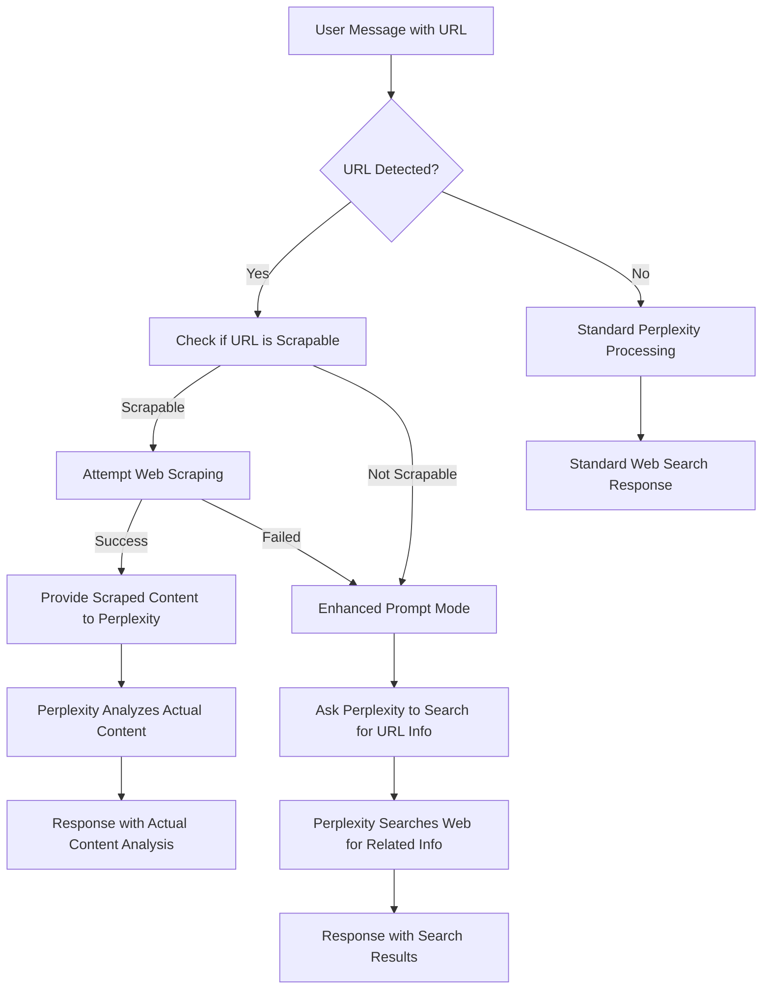

# Web Scraping Integration

DiscordianAI includes intelligent web scraping capabilities to extract actual content from URLs, providing more accurate and contextual responses when users share links.

## Overview

When users include URLs in their messages, the bot:

1. **Automatically detects URLs** using smart pattern matching
2. **Attempts to scrape content** directly from the webpage
3. **Provides scraped content** to Perplexity for analysis
4. **Falls back gracefully** if scraping fails
5. **Logs all activities** for debugging and transparency

## How It Works

### URL Detection and Processing Flow



### Content Extraction Strategy

The web scraper uses intelligent content extraction:

1. **Page Title** - Extracted from `<title>` tag
2. **Meta Description** - From `<meta name="description">` 
3. **Main Content** - Using semantic selectors:
   - `<main>`, `<article>`, `[role="main"]`
   - `.content`, `.post-content`, `.entry-content`
   - `.markdown-body` (for GitHub and similar platforms)
4. **Key Headings** - H1-H3 tags for structure
5. **Clean Text** - Removes navigation, footers, scripts

### Supported Content Types

✅ **Supported URLs:**
- GitHub repositories, pull requests, issues
- News articles and blog posts
- Documentation websites
- General web pages with standard HTML structure

❌ **Unsupported URLs:**
- PDF files, Word documents, spreadsheets
- Archive files (ZIP, TAR, etc.)
- Non-HTTP protocols (FTP, file://, etc.)

## Configuration

### Dependencies

The web scraping feature requires additional Python packages:

```txt
beautifulsoup4>=4.14.3
httpx[http2]>=0.28.1
```

These are automatically included in `requirements.txt` and installed with the bot.

### Scraping Settings

Batch limits come from `src/config.py`, and per-page limits from
`src/web_scraper.py`:

```ini
[Default]
MAX_URLS_PER_MESSAGE=3              # URLs beyond this are ignored
MAX_TOTAL_SCRAPED_CHARS=60000       # Combined text injected into one prompt
SCRAPE_DEADLINE_SECONDS=20          # Deadline for the whole scrape phase
```

```python
# Per-request and per-page limits in src/web_scraper.py
DEFAULT_TIMEOUT = 15  # Per-URL fetch timeout in seconds, including retries
MAX_CONTENT_LENGTH = 50000  # Maximum extracted text per page (~12-15k tokens)
MAX_DOWNLOAD_SIZE = 1000000  # Raw HTML download cap (1MB)
REQUEST_RETRIES = 2  # Two retries after the first attempt
```

### Browser Headers

The scraper uses realistic browser headers to avoid being blocked:

```python
DEFAULT_HEADERS = {
    "User-Agent": "Mozilla/5.0 (Windows NT 10.0; Win64; x64) AppleWebKit/537.36...",
    "Accept": "text/html,application/xhtml+xml,application/xml...",
    "Accept-Language": "en-US,en;q=0.9",
    # ... additional headers for compatibility
}
```

## Logging and Debugging

### What Gets Logged

The web scraper logs diagnostics about the fetch, not the page body:

```python
# URL and lifecycle
logger.info("Starting web scraping for URL: %s", url)
logger.info("Scraped %d chars from %s", original_len, url)

# Status and failures
logger.error("HTTP %s for %s", status, url)
logger.warning("Attempt %d failed for %s: %s", attempt + 1, url, str(e))

# Budgets and truncation
logger.warning(
    "Scraped content capped at %d characters "
    "(MAX_TOTAL_SCRAPED_CHARS); truncated or omitted %d page(s)",
    max_total_chars,
    affected,
)
```

**For Each URL Processing Attempt:**
- The URL being requested and any redirects followed
- The HTTP status or error and the retry attempt
- Refused, timed-out, or over-budget scrapes
- The extracted content length and any truncation notice

**Never Logged:**
- Page text or content previews
- The extraction selector or extraction method
- Response bodies

Scraped text is used only to build the prompt; it is not written to the log.

## Error Handling

### Graceful Degradation

The web scraper implements comprehensive error handling:

1. **Network Errors** - Timeout, connection issues, DNS failures
2. **HTTP Errors** - 404, 403, 500, etc.
3. **Content Errors** - Malformed HTML, empty responses
4. **Size Limits** - Content too large for processing

### Retry Policy

Each URL is attempted up to three times (`REQUEST_RETRIES=2`). Only transient
failures are retried: HTTP 429 and 5xx responses, connect timeouts, and other
transport errors. Other 4xx responses and non-connect timeouts stop
immediately. Retry waits are 1s, then 2s; a 429 may instead honour
`Retry-After` up to 30s. The per-URL 15-second fetch timeout and the 20-second
batch deadline still apply.

### Fallback Strategy

When web scraping fails, the bot:

1. **Logs the failure** with specific error details
2. **Falls back to enhanced prompts** asking Perplexity to search for URL information
3. **Continues processing** without breaking the conversation flow
4. **Provides helpful messages** explaining limitations when appropriate

## Performance Considerations

### Asynchronous Processing

- Scraping uses asynchronous HTTP and DNS-offload APIs, so it does not block the bot's event loop
- Distinct hosts are scraped concurrently under a two-host semaphore; requests to the same host are serialized with a 1–3 second politeness delay
- A 15-second per-URL fetch timeout and a 20-second batch deadline prevent hanging requests

### Content Limits

- **3 URLs per message** by default; extras are ignored
- **60,000-character aggregate budget** for scraped page text injected into one prompt by default
- **50,000 characters per page** of extracted text (~12-15k tokens)
- **1MB raw HTML** download cap with automatic truncation indicators

### Caching

The scraper does not cache pages, and Perplexity requests are not
response-cached, so a repeated URL message is scraped again. The response cache
with TTL-based expiry applies to OpenAI responses only.

## Usage Examples

### GitHub Pull Request Analysis

```
User: "Check out this PR: https://github.com/johndotpub/DiscordianAI/pull/197"

Bot Process:
1. Detects GitHub URL
2. Scrapes PR content (title, description, commits, status)
3. Provides scraped content to Perplexity
4. Perplexity analyzes actual PR content
5. Returns detailed analysis with citations

Response: "I've analyzed the pull request content directly..."
```

### Multiple URL Processing

```
User: "Compare these articles: https://site1.com/article1 https://site2.com/article2"

Bot Process:
1. Detects both URLs
2. Scrapes content from both articles
3. Provides combined content to Perplexity
4. Perplexity compares actual article content
5. Returns comprehensive comparison

Response: "Based on the content from both articles..."
```

### Fallback Handling

```
User: "What's in this PDF? https://example.com/document.pdf"

Bot Process:
1. Detects PDF URL
2. Recognizes PDF is not scrapable
3. Uses enhanced prompt mode
4. Perplexity searches for information about the URL
5. Returns search-based response with fallback notice

Response: "I searched for information about this document... 
**Note**: I couldn't access the PDF directly..."
```

## Troubleshooting

### Common Issues

**Web scraping fails for specific sites:**
- Some sites block automated requests
- JavaScript-heavy sites may not render content
- Authentication-required pages are inaccessible
- Rate limiting by the target website

**Large content handling:**
- Extracted text over 50,000 characters per page is automatically truncated
- Total injected scraped text is capped at `MAX_TOTAL_SCRAPED_CHARS` (default 60,000)
- Truncation notices are added to responses
- Token limits prevent API overload

### Debug Information

Enable debug logging to see detailed web scraping information:

```ini
[Logging]
LOG_LEVEL=DEBUG
```

This will show:
- URL validation results
- HTTP request/response details
- Content extraction process
- Scraping success/failure reasons
- Fallback activation triggers
